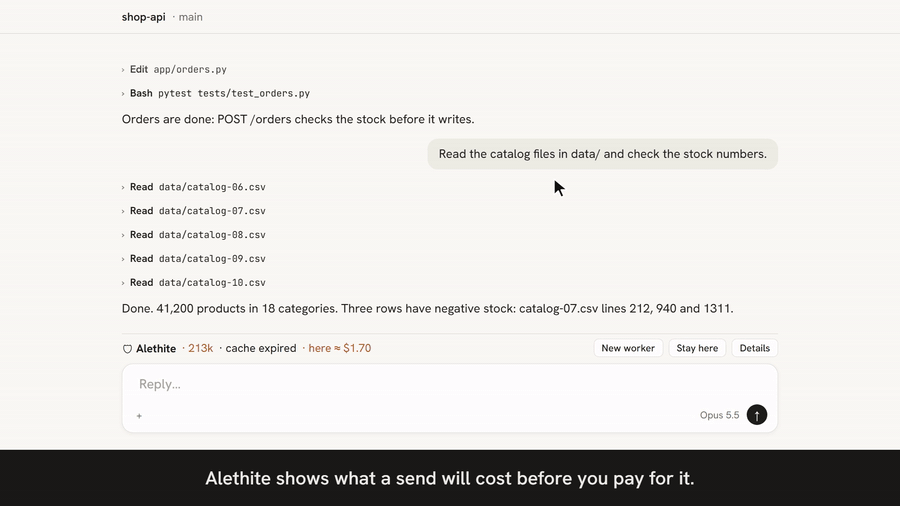
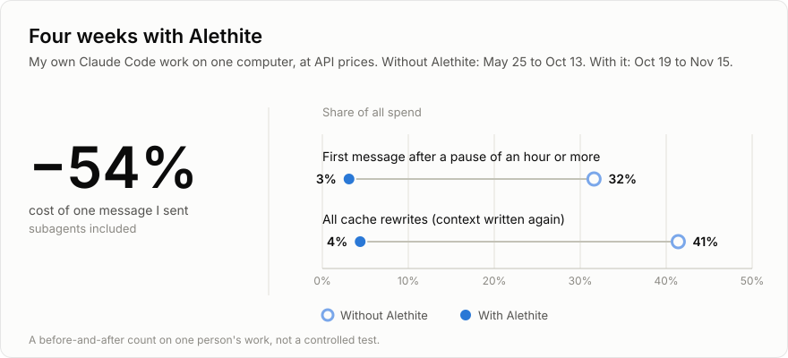

<div align="center">


# Alethite

**Cheaper long chats in Claude Code. Memory that stays.**

A free, MIT-licensed plugin for the Claude Code desktop app on Windows.

[](LICENSE)


**English** · [Русский](README.ru.md) · [Українська](README.uk.md)



</div>

---

## 💸 Why

I audited my own Claude Code transcripts (May to October 2026, at API prices) to see where the money goes.

- **89%** went on re-sending context that already existed (cache writes and reads).
- **32%** went on the first message after a pause of over an hour in a big chat. The one-hour cache had expired, so the whole context was written again at double price.

The money goes on coming back to a big idle chat. Alethite shows you the price before you pay it, and keeps a memory of your past chats so a fresh one starts informed.

After four weeks with Alethite (October 19 to November 15, same computer, API prices) each message I sent cost about half as much, subagents included. The first message after a long pause went from 32% of all spend to 3%. This is a before-and-after count on one person's work, not a controlled test.

<picture><source media="(prefers-color-scheme: dark)" srcset="assets/before-after-dark.svg"></picture>

The same count showed where the money goes now. Subagents grew to 44% of all spend, and nearly half of their cost is the start every agent pays before it does any work. A general-purpose agent starts with about 64k tokens of tool descriptions, skill lists and instructions. Alethite now ships lean agent types that start with 5-16k.

---

## ✨ What you get

| Feature | What it does | Command |
|---|---|---|
| 🛡️ **Cache guard** | The status line shows the context size and the minutes left in the cache. One row above the prompt is always there: chat size, cache, the price of a send here and how much the handoffs and the lean agents saved. The Details button opens it into columns. | `/al-band` |
| 🆕 **New worker** | A button that starts a clean chat with a handoff of the old one (no model calls) and the message you already typed. The After reset button does the same once a limit resets. It shows up after you press New worker. It needs the reset time that Claude Code reports with every reply. The plugin keeps the last one, so the button is there in a new chat and after a restart too, until that time passes. When there is more than one time to pick (the 5-hour reset and the reset of each limit at 90% or more), it asks for the time first. Then it asks for the model: the current one, opus or sonnet. If the third-party plugin [ponytail](https://github.com/DietrichGebert/ponytail) is installed, the main chat is told once, when the chat has 5 unreviewed code edits, and asks you before the handoff whether to run `/ponytail-review`. The band shows nothing of it. | buttons in the band |
| 📝 **Short memory** | One short rule for Claude: write decisions down at once, save an understood error as a lesson, check memory before proposing. A toast shows each saved fact. | |
| 🔎 **Long memory** | Every past conversation of every project, subagents included, in a local SQLite index with vectors from a local Ollama model. Claude searches it with `recall`, by words and by meaning. Secrets are hidden before indexing. Nothing that got into the index is ever lost, and tool errors are indexed too. | `/al-index` |
| 🎓 **Lessons** | An understood error is saved as a lesson and comes back only where it fits. A command that holds a lesson's trigger is stopped once with it, and at most 2 lessons come per message. No fitting lesson, zero tokens. A lesson can also be for all projects (`scope: all`). That kind is the exception: it comes as a short reminder every ~20k tokens of chat and costs those tokens in every project. The reminder holds at most 1000 characters, newest first, and older rules that do not fit stay out of the reminder. They stay in `/al-lessons`, and their triggers still stop commands. | `/al-lessons` |
| 🔄 **Sync between computers** | A shared folder on a network drive carries the index, the vectors and the memory facts. Without it everything works locally. | `/al-sync` |
| 🗜️ **Memory compression** | What the plugin hands to the model is squeezed mechanically, in four levels. Code, paths and negations are never touched. | `/al-stats` |
| ⏱️ **Background job** | A Task Scheduler task keeps the index, the vectors and the sync fresh with no chat open. Windows only. | `/al-job` |
| 🔐 **Encryption** | Optional. Encrypts the index on disk and everything your computer puts in the sync folder. Windows only. | `/al-encrypt` |
| 🌍 **Languages** | English, Russian, Ukrainian: the interface, the texts for the model and the handoff. | |

---

## 🚀 Quick start

You need the Claude Code desktop app (engine 2.1.295 or newer) and Python 3.8+. Ollama is optional, but without it the search goes by words only. numpy is needed only for the vectors. Run the commands in PowerShell.

The first line finds the desktop app's own `claude.exe` and must print a path ending in `claude.exe` (if it prints nothing, INSTALL.md has a wider search). The other two install the plugin from GitHub, no clone needed:

```powershell
$CC = (Get-ChildItem "$env:LOCALAPPDATA\Claude-Data\claude_*\claude-code\*\*\claude.exe", "$env:APPDATA\Claude\claude-code\*\*\claude.exe", "$env:LOCALAPPDATA\Packages\Claude_*\LocalCache\Roaming\Claude\claude-code\*\*\claude.exe" -ErrorAction SilentlyContinue | Sort-Object LastWriteTime | Select-Object -Last 1).FullName; $CC
& $CC plugin marketplace add GladLuter/Alethite
& $CC plugin install alethite@alethite
```

Restart the app and type `/al-health` in a new chat to check it. The plugin builds the index by itself 3 seconds after a chat starts. Computing the vectors (it takes hours the first time), updating and working from a clone are in **[INSTALL.md](INSTALL.md)**.

---

## ⌨️ Commands

| Command | What it does |
|---|---|
| `/al-health` | Checks the plugin, the index, the vectors, the memory, the sync and the compression |
| `/al-band [off]` | Brings the band back, or hides it in this chat (`off`) |
| `/al-index [rebuild]` | Updates the index. `rebuild` re-reads everything and adds what is missing |
| `/al-sync [skip <computer> <N>]` | Syncs with the other computers now |
| `/al-stats [days]` | Measures the cost and writes it to Obsidian |
| `/al-lessons [forget <pos>]` | Lists the lessons of this project and for all projects, or deletes one |
| `/al-job [on [minutes] \| off]` | The background job (Windows): on, off, its state |
| `/al-encrypt [on \| join \| off \| status]` | Encryption of the index and the sync folder (Windows) |
| `/al-index-dir [folder]` | Moves the index to another local disk (Windows). Without a folder, a window asks for one |
| `/al-cleanup [on \| off]` | Deletes the old chat from disk after a New worker handoff, once all of it is in the index. Off by default. Permanent |

---

<details>
<summary><b>⚙️ Settings</b></summary>

<br>

The file `%USERPROFILE%\.claude\alethite\settings.json` is one per computer. The plugin creates it at the first start with all the current values, so you only open it and edit. The plugin adds a missing key itself at the start of a chat, with the value from `/config`. The background job reads only the file. Its values win over `/config`. After an edit, type `/reload-plugins`. Backslashes in JSON are doubled.

| Key | What it sets | Default |
|---|---|---|
| `language` | Language | `"en"` (also `"ru"`, `"uk"`) |
| `compression` | Memory compression | `"ultra"` (also `"off"`, `"lite"`, `"full"`) |
| `syncDir` | Sync folder | `""` (empty: no sync) |
| `bandMinTokens` | Row highlight: chat size, tokens | `100000` |
| `bandIdleMinutes` | Row highlight: idle time, minutes | `55` |
| `showLimits` | Limits column in Details | `true` |
| `python` | Python command, one executable with no arguments | `"python"` |
| `embedModel` | Ollama embedding model | `"embeddinggemma"` |
| `lessons` | Bring lessons back to messages and commands. Off also stops the reminder of rules for all projects (every ~20k tokens) | `true` |
| `lessonsMinScore` | How close a message must be (0 to 1) | `0.45` |
| `indexCipher` | How the index is encrypted (`/al-encrypt on` writes it) | `"sqlcipher"` (also `"efs"`) |
| `shareCipher` | How the sync folder is encrypted (`/al-encrypt on` writes it). `"cryptography"` is the AES-GCM built into Windows | `"sqlcipher"` (also `"cryptography"`) |
| `indexDir` | The index folder (written by `/al-index-dir`, do not edit by hand) | no key |
| `projectAliases` | Old folders whose memory a project folder also sees: `{"C:\\work\\new": ["C:\\work\\old"]}` | no key |

The file may hold only the keys you change:

```json
{
  "language": "ru",
  "syncDir": "\\\\NAS\\share\\alethite"
}
```

</details>

<details>
<summary><b>🔐 Encryption details</b></summary>

<br>

Until you run `/al-encrypt on`, nothing changes for you. The key sits in `settings.json`, protected by Windows. The recovery code is shown once, in a window. Put it in a password manager. A second computer joins with `/al-encrypt join`.

The index and the sync folder each have their own cipher:

- Index: SQLCipher (needs the `sqlcipher3` package) or EFS, the file encryption of Windows itself (needs Windows Pro and an NTFS drive, no packages).
- Sync folder: SQLCipher or AES-GCM, which is built into Windows, no packages.

Smart App Control may refuse to load `sqlcipher3`. Under it only EFS and AES-GCM work.

With EFS, a copy of the index on a FAT or exFAT stick or over the network comes out unencrypted, and the files open only under the same Windows account.

Claude Code's own transcripts, each project's auto-memory files and the text of a handoff that goes into the chat stay plain. With EFS the handoff files on disk are encrypted.

Full walkthrough: [INSTALL.md](INSTALL.md).

</details>

---

## 🪶 Lean agent types

Alethite ships five agent types (`scout`, `researcher`, `reviewer`, `coder`, `resident`) that start with only the tools they need. They start with 5-16k tokens, against about 64k for the built-in `general-purpose` on the author's computer. The main chat is told to pick them. Types, tools and details are in [INSTALL.md](INSTALL.md#lean-agent-types).

## 📋 Requirements

- The Claude Code desktop app, engine 2.1.295 or newer
- Python 3.8+ (numpy only for the vectors)
- git, only to work from a clone
- Ollama, for the search by meaning (optional)
- The `sqlcipher3` package for the SQLCipher ciphers (optional, Windows only)
- Windows Pro and an NTFS drive for the EFS cipher (optional)

## 🔒 Privacy

The index and the vectors hold your conversations. They stay on your computers and your network folder. They are never in this repository and never sent anywhere else. The only network calls go to your local Ollama, to your shared folder and, for `/al-stats`, to your Obsidian MCP server.

## 📄 License

[MIT](LICENSE). Free to use, copy and change.

## 📚 Documents

| Document | English | Русский | Українська |
|---|---|---|---|
| Installation | [INSTALL.md](INSTALL.md) | [INSTALL.ru.md](INSTALL.ru.md) | [INSTALL.uk.md](INSTALL.uk.md) |

Used the old private CacheGuard plugin? There is a moving section in [INSTALL.md](INSTALL.md#from-cacheguard).
