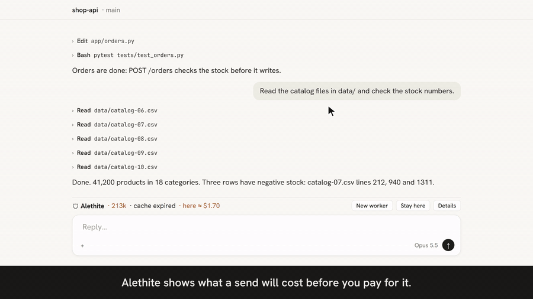
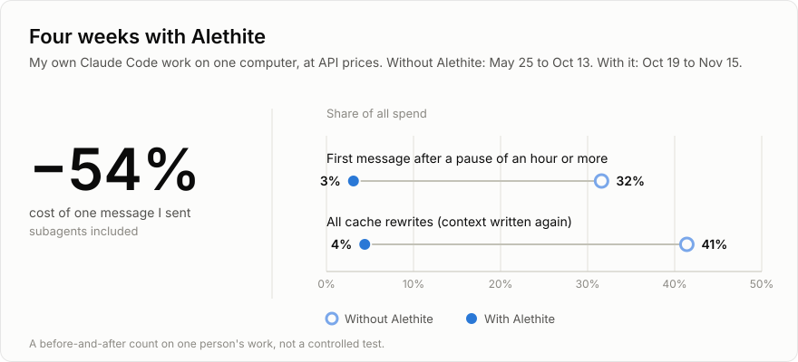

<div align="center">


# Alethite

**Довгі чати в Claude Code дешевші. Пам'ять лишається.**

Безкоштовний плагін за ліцензією MIT для десктопного застосунку Claude Code на Windows.

[](LICENSE)


[](https://hub.xerj.org/contributors/GladLuter)

[English](README.md) · [Русский](README.ru.md) · **Українська**



</div>

---

## 💸 Навіщо

Я перевірив власні транскрипти Claude Code (травень-жовтень 2026, за цінами API), щоб зрозуміти, куди йдуть гроші.

- **89%** пішло на повторне надсилання контексту, який уже є (запис у кеш і читання з нього).
- **32%** пішло на перше повідомлення після паузи понад годину у великому чаті. Годинний кеш сплив, і весь контекст записався заново за подвійною ціною.

Гроші йдуть на повернення до великого чату, що довго простоював. Alethite показує ціну до надсилання й зберігає пам'ять про минулі чати, тож новий чат починає не з нуля.

За п'ять тижнів з Alethite (з 19 жовтня по 23 листопада, той самий комп'ютер, ціни API) кожне моє повідомлення коштувало приблизно вдвічі дешевше, враховуючи субагентів. Перше повідомлення після довгої паузи забирало 32% усіх витрат, тепер 3%. Це підрахунок «до і після» на роботі однієї людини, а не контрольований експеримент.

<picture><source media="(prefers-color-scheme: dark)" srcset="assets/before-after-dark.svg"></picture>

Той самий підрахунок показав, куди гроші йдуть тепер. З 19 жовтня по 15 листопада субагенти виросли до 44% усіх витрат, і майже половина їхньої ціни припадає на старт, який кожен агент оплачує ще до початку роботи. Звичайний агент (general-purpose) стартує приблизно з 64 тис. токенів описів інструментів, списків навичок та інструкцій. Тепер Alethite постачає легкі типи агентів зі стартом 5-16 тис. З 16 по 23 листопада субагенти взяли 34% витрат. 214 з 231 старту були легкими, і витрати на субагентів стали на 16% менші, ніж з такими самими стартами general-purpose.

---

## ✨ Що ви отримуєте

| Функція | Що робить | Команда |
|---|---|---|
| 🛡️ **Сторож кешу** | У рядку стану видно розмір контексту й хвилини до спливу кешу. Над полем вводу завжди стоїть один рядок: розмір чату, кеш, ціна надсилання сюди й скільки заощадили передачі справ і легкі агенти. Кнопка «Деталі» розгортає його в колонки. | `/al-band` |
| 🆕 **Новий працівник** | Кнопка починає чистий чат: передача справ зі старого (без викликів моделі) і повідомлення, яке ви вже набрали. Кнопка «Після скидання» робить те саме, коли скинеться ліміт. Вона з'являється після натискання «Новий працівник». Їй потрібен час скидання, який Claude Code повідомляє з кожною відповіддю. Плагін пам'ятає останній, тому кнопка є і в новому чаті, і після перезапуску, доки цей час не минув. Якщо варіантів часу кілька (5-годинне скидання і скидання кожного ліміту, що на 90% або більше), вона спершу питає час. Потім модель: поточна, opus або sonnet. Якщо встановлено сторонній плагін [ponytail](https://github.com/DietrichGebert/ponytail), головний чат дізнається про це один раз, коли в ньому набралося 5 правок коду без ревю, і перед передачею питає вас, чи провести `/ponytail-review`. Смуга нічого про це не показує. | кнопки в смузі |
| ⏳ **Фонові процеси** | Для запуску довшого за 10 хвилин агент викликає `background_run`. Над полем введення з'являється рядок: назва запуску, скільки він іде й останній рядок файлу статусу. Очікування не коштує токенів, мод лише читає файли. Коли запуск закінчується, агент отримує результат повідомленням від вашого імені й іде далі. Якщо кеш охолов, ви обрали наперед: лише показати результат або почати Нового працівника. Лише Windows. | інструмент `background_run` |
| 📝 **Коротка пам'ять** | Одне коротке правило для Claude: рішення записувати одразу, зрозумілу помилку зберігати уроком, перед пропозицією перевіряти пам'ять. Кожен збережений факт показується сповіщенням. | |
| 🔎 **Довга пам'ять** | Усі минулі розмови всіх проєктів, разом із субагентами, у локальному індексі SQLite з векторами локальної моделі Ollama. Claude шукає в них через `recall`, за словами й за змістом. Секрети приховуються до індексації. Ніщо з того, що потрапило в індекс, не губиться. Помилки інструментів теж індексуються. | `/al-index` |
| 🎓 **Уроки** | Зрозуміла помилка зберігається уроком і повертається лише там, де доречна. Команда з тригером уроку один раз зупиняється разом з ним, і на повідомлення приходить не більше 2 уроків. Немає доречного уроку, отже нуль токенів. Урок буває й для всіх проєктів (`scope: all`). Це виняток: він приходить коротким нагадуванням приблизно кожні 20 тис. токенів чату й коштує цих токенів у кожному проєкті. У нагадування влазить не більше 1000 символів, спершу нові, а старі правила, що не вмістилися, у нагадування не потрапляють. Вони лишаються в `/al-lessons`, і їхні тригери, як і раніше, зупиняють команди. | `/al-lessons` |
| 🔄 **Синхронізація комп'ютерів** | Спільна тека на мережевому диску переносить індекс, вектори й факти пам'яті. Без неї все працює локально. | `/al-sync` |
| 🗜️ **Стиснення пам'яті** | Те, що плагін віддає моделі, стискається механічно, на чотирьох рівнях. Код, шляхи й заперечення не чіпаються. | `/al-stats` |
| ⏱️ **Фонове завдання** | Завдання Планувальника тримає індекс, вектори й синхронізацію свіжими, навіть коли жоден чат не відкритий. Лише Windows. | `/al-job` |
| 🔐 **Шифрування** | За бажанням. Шифрує індекс на диску й усе, що комп'ютер кладе в теку синхронізації. Лише Windows. | `/al-encrypt` |
| 🌍 **Мови** | Українська, російська, англійська: інтерфейс, тексти для моделі й передача справ. | |

---

## 🚀 Швидкий старт

Потрібні десктопний застосунок Claude Code (рушій 2.1.295 або новіший) і Python 3.8+. Ollama необов'язкова, але без неї пошук іде лише за словами. numpy потрібен лише для векторів. Команди виконуйте в PowerShell.

Перший рядок знаходить власний `claude.exe` десктопного застосунку й має надрукувати шлях, що закінчується на `claude.exe` (якщо він нічого не друкує, в INSTALL.uk.md є ширший пошук). Два інші ставлять плагін з GitHub, клон не потрібен:

```powershell
$CC = (Get-ChildItem "$env:LOCALAPPDATA\Claude-Data\claude_*\claude-code\*\*\claude.exe", "$env:APPDATA\Claude\claude-code\*\*\claude.exe", "$env:LOCALAPPDATA\Packages\Claude_*\LocalCache\Roaming\Claude\claude-code\*\*\claude.exe" -ErrorAction SilentlyContinue | Sort-Object LastWriteTime | Select-Object -Last 1).FullName; $CC
& $CC plugin marketplace add GladLuter/Alethite
& $CC plugin install alethite@alethite
```

Перезапустіть застосунок і наберіть `/al-health` у новому чаті для перевірки. Індекс плагін будує сам через 3 секунди після старту чату. Обчислення векторів (першого разу воно триває кілька годин), оновлення та робота з клоном описані в **[INSTALL.uk.md](INSTALL.uk.md)**.

---

## ⌨️ Команди

| Команда | Що робить |
|---|---|
| `/al-health` | Перевіряє плагін, індекс, вектори, пам'ять, синхронізацію й стиснення |
| `/al-band [off]` | Повертає смугу або ховає її в цьому чаті (`off`) |
| `/al-index [rebuild]` | Оновлює індекс. `rebuild` перечитує все й додає бракуюче |
| `/al-sync [skip <комп'ютер> <N>]` | Синхронізує з іншими комп'ютерами зараз |
| `/al-stats [days]` | Вимірює вартість і записує в Obsidian |
| `/al-lessons [forget <pos>]` | Показує уроки проєкту й для всіх проєктів або видаляє один |
| `/al-job [on [хвилини] \| off]` | Фонове завдання (Windows): увімкнути, вимкнути, стан |
| `/al-encrypt [on \| join \| off \| status]` | Шифрування індексу й теки синхронізації (Windows) |
| `/al-index-dir [тека]` | Переносить індекс на інший локальний диск (Windows). Без теки її обирають у вікні |
| `/al-cleanup [on \| off]` | Видаляє з диска старий чат після передачі справ кнопкою «Новий працівник», коли все з нього вже в індексі. Типово вимкнено. Незворотно |

---

<details>
<summary><b>⚙️ Налаштування</b></summary>

<br>

Файл `%USERPROFILE%\.claude\alethite\settings.json` свій на кожному комп'ютері. Плагін створює його під час першого запуску з усіма поточними значеннями, тож лишається відкрити й виправити. Відсутній ключ плагін дописує сам на початку чату, зі значенням із `/config`. Фонове завдання читає лише файл. Його значення мають перевагу над `/config`. Після правки наберіть `/reload-plugins`. Зворотні скісні риски в JSON подвоюються.

| Ключ | Що задає | За замовчуванням |
|---|---|---|
| `language` | Мова | `"en"` (також `"ru"`, `"uk"`) |
| `compression` | Стиснення пам'яті | `"ultra"` (також `"off"`, `"lite"`, `"full"`) |
| `syncDir` | Тека синхронізації | `""` (порожньо: без синхронізації) |
| `bandMinTokens` | Підсвічування рядка: розмір чату, токени | `100000` |
| `bandIdleMinutes` | Підсвічування рядка: простій, хвилини | `55` |
| `showLimits` | Колонка лімітів у «Деталях» | `true` |
| `python` | Команда Python, один виконуваний файл без аргументів | `"python"` |
| `embedModel` | Модель ембеддингів Ollama | `"embeddinggemma"` |
| `lessons` | Повертати уроки до повідомлень і команд. Вимкнення зупиняє й нагадування правил для всіх проєктів (раз на ~20 тис. токенів) | `true` |
| `lessonsMinScore` | Наскільки близьким має бути повідомлення (0-1) | `0.45` |
| `indexCipher` | Як шифрується індекс (`/al-encrypt on` записує сам) | `"sqlcipher"` (також `"efs"`) |
| `shareCipher` | Як шифрується тека синхронізації (`/al-encrypt on` записує сам). `"cryptography"` означає AES-GCM, вбудований у Windows | `"sqlcipher"` (також `"cryptography"`) |
| `indexDir` | Тека індексу (пише `/al-index-dir`, вручну не правити) | немає ключа |
| `projectAliases` | Старі теки, чию пам'ять бачить і тека проєкту: `{"C:\\work\\new": ["C:\\work\\old"]}` | немає ключа |

У файлі можуть бути лише ті ключі, які ви змінюєте:

```json
{
  "language": "ru",
  "syncDir": "\\\\NAS\\share\\alethite"
}
```

</details>

<details>
<summary><b>🔐 Докладніше про шифрування</b></summary>

<br>

Доки ви не виконали `/al-encrypt on`, для вас нічого не змінюється. Ключ лежить у `settings.json` під захистом Windows. Код відновлення показується один раз, у вікні. Збережіть його в менеджері паролів. Другий комп'ютер долучається командою `/al-encrypt join`.

В індексу й теки синхронізації свої шифри:

- Індекс: SQLCipher (потрібен пакет `sqlcipher3`) або EFS, шифрування файлів самої Windows (потрібні Windows Pro і диск NTFS, пакети не потрібні).
- Тека синхронізації: SQLCipher або AES-GCM, він вбудований у Windows, пакети не потрібні.

Smart App Control може відмовитися завантажувати `sqlcipher3`. Тоді працюють лише EFS і AES-GCM.

За EFS копія індексу на флешці FAT чи exFAT або мережею вийде нешифрованою, а файли відкриваються лише під тим самим обліковим записом Windows.

Власні транскрипти Claude Code, файли автопам'яті кожного проєкту й текст передачі справ, що йде в чат, лишаються відкритими. За EFS файли передачі справ на диску зашифровані.

Повна інструкція: [INSTALL.uk.md](INSTALL.uk.md).

</details>

---

## 🪶 Легкі типи агентів

Alethite постачає п'ять типів агентів (`scout`, `researcher`, `reviewer`, `coder`, `resident`), які стартують лише з потрібними їм інструментами. Їхній старт 5-16 тис. токенів, у вбудованого `general-purpose` на комп'ютері автора близько 64 тис. Головному чату велено обирати їх. Типи, інструменти й подробиці в [INSTALL.uk.md](INSTALL.uk.md#легкі-типи-агентів).

## 📋 Вимоги

- Десктопний застосунок Claude Code, рушій 2.1.295 або новіший
- Python 3.8+ (numpy лише для векторів)
- git, лише для роботи з клону
- Ollama для пошуку за змістом (необов'язково)
- Пакет `sqlcipher3` для шифрів SQLCipher (необов'язково, лише Windows)
- Windows Pro і диск NTFS для шифру EFS (необов'язково)

## 🔒 Конфіденційність

Індекс і вектори зберігають ваші розмови. Вони лишаються на ваших комп'ютерах і у вашій мережевій теці. У цьому репозиторії їх немає, і кудись ще вони не надсилаються. Мережеві звернення йдуть лише до вашої локальної Ollama, до вашої спільної теки та, для `/al-stats`, до вашого MCP-сервера Obsidian.

## 📄 Ліцензія

[MIT](LICENSE). Можна вільно використовувати, копіювати й змінювати.

## 📚 Документи

| Документ | English | Русский | Українська |
|---|---|---|---|
| Встановлення | [INSTALL.md](INSTALL.md) | [INSTALL.ru.md](INSTALL.ru.md) | [INSTALL.uk.md](INSTALL.uk.md) |

Користувалися старим приватним плагіном CacheGuard? Про перехід написано в [INSTALL.uk.md](INSTALL.uk.md#з-cacheguard).
